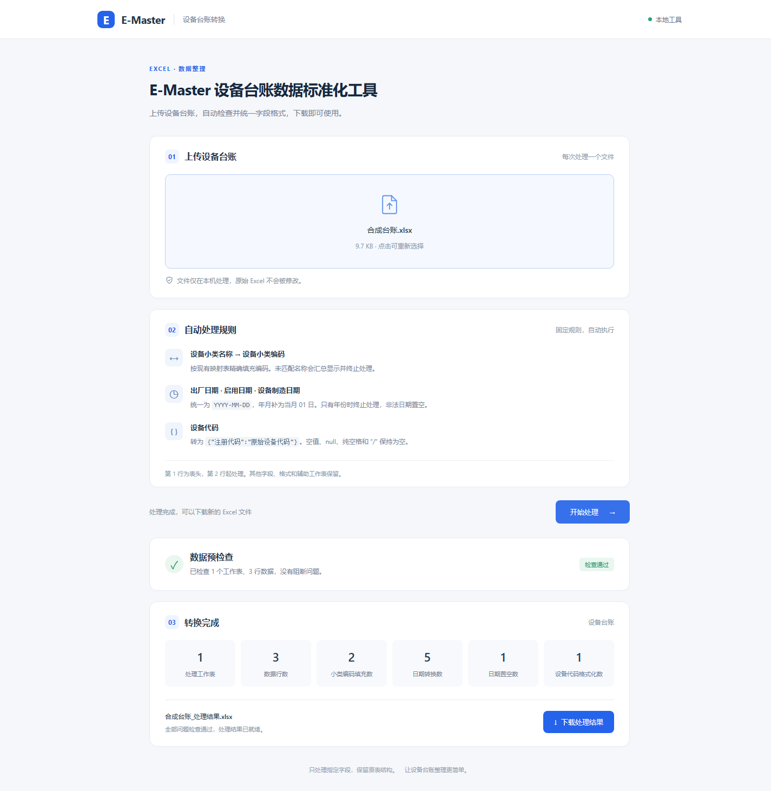

# E-Master 设备台账 Excel 格式转换工具

上传一个 `.xlsx`，工具先检查所有业务工作表，通过后统一指定字段，下载一个新的 Excel。
原始文件保持只读；输入要求和完整规则见 [PROJECT_SPEC.md](PROJECT_SPEC.md)。

## 启动

在项目目录运行：

```powershell
.\.venv\Scripts\python.exe -m ui.local_app
```

浏览器打开 <http://127.0.0.1:8765>，选择或拖入一个文件，点击“开始处理”。
通过检查后点击“下载处理结果”，文件名为 `原文件名_处理结果.xlsx`。
按 `Ctrl+C` 停止服务，服务会清理临时下载副本。端口占用时可添加 `--port 8766`。

新环境安装：

```powershell
python -m venv .venv
.\.venv\Scripts\python.exe -m pip install -r requirements.txt
```

## 输入及规则

- 每次一个 `.xlsx`，最大 32 MB。第 1 行为精确字段表头，第 2 行起处理。
- 设备小类名称按 `docs/设备小类编码字段映射配置文件.xlsx` 精确填充设备小类编码。
  映射每次重新读取；修改配置时保留上述两个表头，并确保名称与编码一一对应。
- 出厂日期、启用日期、设备制造日期转为文本 `YYYY-MM-DD`；年月补 01 日，非法日期置空。
- 设备代码转为合法 JSON 文本 `{"注册代码":"原值"}`；空、纯空格、`null`、`/` 转为空单元格。
- 未匹配名称、只有年份的日期、重复目标表头、缺少编码列、目标公式或目标合并单元格会阻断。
  页面列出工作表、Excel 行号、单元格、字段、原值和问题说明，修正后重新选择文件处理。
- 隐藏、非常隐藏和名称以 `hidden@` 开头的工作表跳过；无目标字段的可见工作表跳过。
  表头、非目标列、其他公式、格式、辅助表、图片及原始 OOXML 部件保留。
- 文本设备代码的前导零保留，纯零数字格式的补零保留；Excel 已丢失的数字精度无法恢复。

随附 `docs/安全阀台账模版-2026.10.09.xlsx` 的 39 行数据使用“安全阀”，当前映射表没有该名称。
工具会完整列出这 39 项问题并停止；使用前需要在映射表中补充业务确认的编码。

## 验证

```powershell
.\.venv\Scripts\python.exe -m pip install -r requirements-dev.txt
.\.venv\Scripts\python.exe -m pytest -q
.\.venv\Scripts\python.exe -m compileall -q excel_qc ui tests
node tests/browser_smoke.mjs
```

浏览器验收需要 Windows、Edge 和支持内置 WebSocket 的 Node.js 22 或更新版本；
脚本自动启动临时本地服务并在结束后停止，不需要第三方浏览器库。
当前实测环境为 Node.js 24.19.0。测试样本和下载保存在系统临时目录，原件及映射保持只读。

当前验收：97 项测试通过，实际 Edge 上传、处理、下载回读及窄屏页面检查通过。
详情见 [验收记录](docs/conversion-acceptance.md)。


