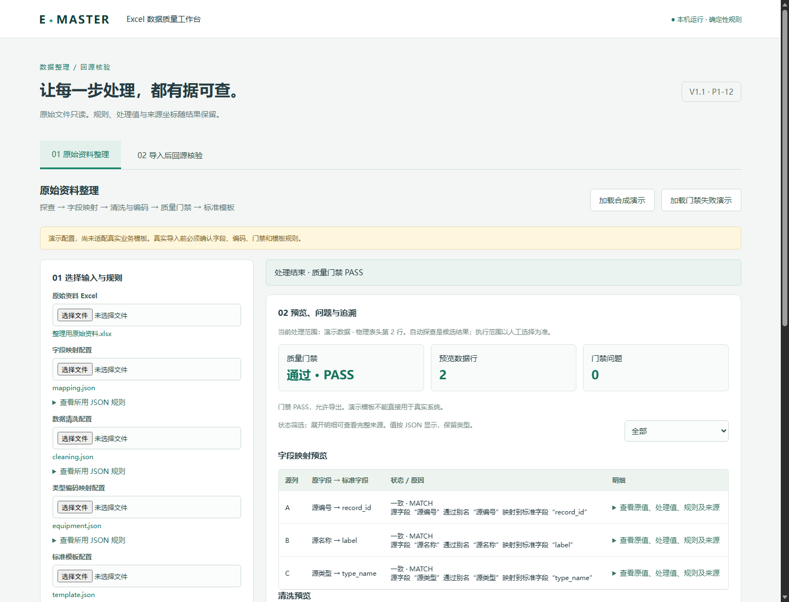
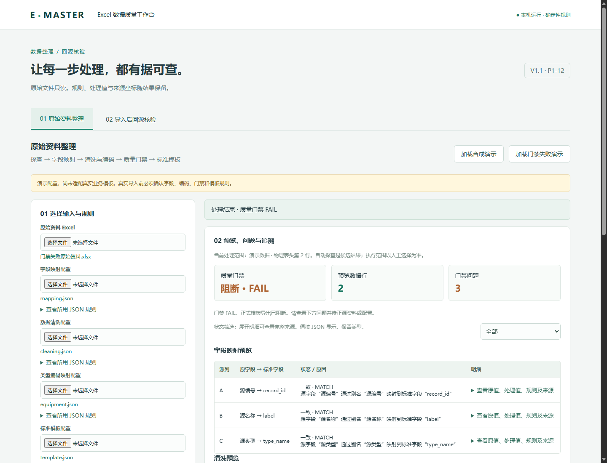
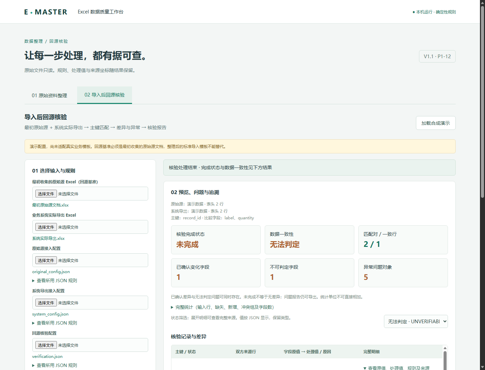
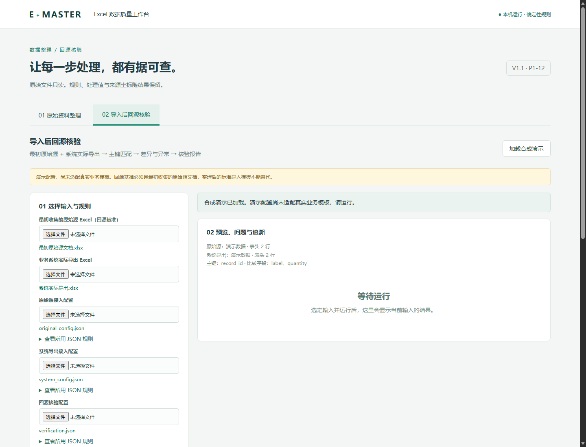
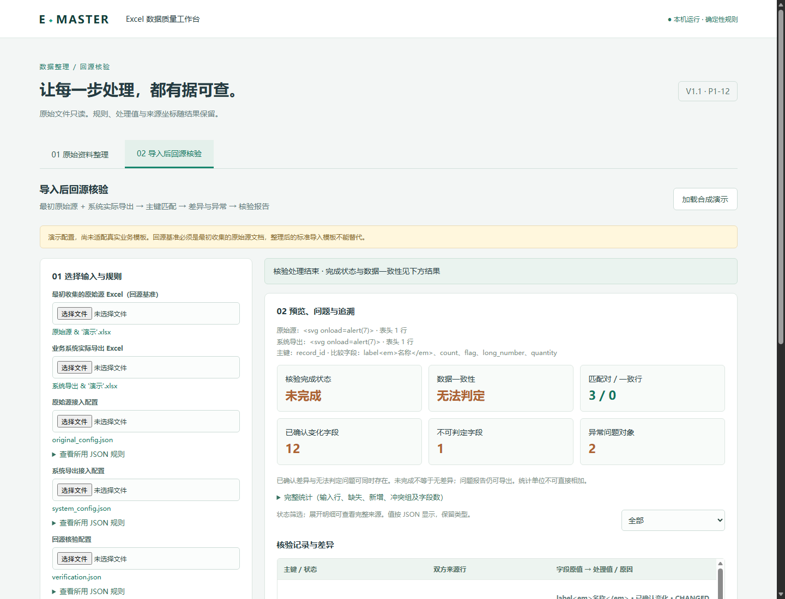
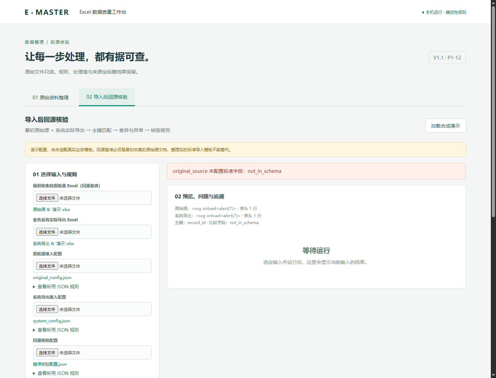

# P1-12 UI 整合

状态（2026-10-13）：**P1-12 技术验收通过**，用户界面体验确认及用户验收待办。
P1-11 AI 辅助能力为 **TODO，暂缓**，保留规划，不计为完成。
P1-13 批量处理和 P1-14 最终验收尚未开始；真实业务样本验证仍待办。
P1-10 已提交 `b5bd943`，用户验收没有新增确认，不据提交事实改写验收状态。

## 技术选择与入口

原 `ui/display.py` / `ui/html.py` 提供 V1.0 结果的静态 HTML 展示，
没有文件选择、执行和状态管理。新增标准库 `ThreadingHTTPServer` 与
HTML/CSS/JavaScript 本地交互页面，复用 Python/openpyxl 核心，不新增依赖。
本地 Tk 探测因 Tcl 初始化路径失败而无法启动；浏览器方案不依赖该环境，
也不需要 FastAPI、前端构建工具、登录、多用户、数据库或云部署。
`main.py`、`e_master/`、旧测试及历史文档没有改动。

现有项目虚拟环境已可运行，启动不需要安装任何 UI 或 AI 包：

```powershell
Set-Location 'D:\Python_code\E-Master'
.\.venv\Scripts\python.exe -m ui.local_app
```

浏览器打开 `http://127.0.0.1:8765`。占用时使用
`.\.venv\Scripts\python.exe -m ui.local_app --port 8766`，访问对应端口。
服务固定绑定 `127.0.0.1`，不提供任意主机绑定选项；Ctrl+C 停止。
新环境需要标准 Python 3.12、openpyxl 与项目测试环境；产品运行本身只需
标准库和已有 openpyxl，不需要 requirements.txt 中的历史 AI 包。

入口 `ui/local_app.py` 管理本地请求、文件快照和会话；`ui/workflows.py`
管理输入版本、接口编排和导出资格；`ui/web/` 收集配置、显示结果与交互状态。
界面不执行字段映射、清洗、编码、匹配、比较或报告生成算法。

## 可复用调用链

原始资料整理：

```text
profile_workbook（上传时自动结构探查）
  → profile_configured_sheet（人工指定 Sheet / 物理表头）
  → map_workbook_fields → clean_workbook → map_equipment_type_codes
  → build_standard_template → run_quality_gate
  → 仅 PASS：export_standard_template
```

新增公共 `excel_qc.profile_configured_sheet(path, sheet_name, header_row_number)`
复用 P1-08 既有 `_configured_sheet_profile`，返回单 Sheet 的 `WorkbookProfile`。
不改变旧接口与 P1-08/P1-09 行为。自动探查的类型、数量、样例仍是候选特征；
实际数据处理范围取人工指定表头之后到最后有效行，保留中间物理空行。

导入后回源核验：

```text
load_system_export_config（双方接入 JSON）
  → 源侧转换为 OriginalSourceConfig；核验 JSON 装配 SourceVerificationConfig
  → verify_source_against_system_export（内部复用 P1-08）
  → export_source_verification_report
```

源侧只是复用接入配置格式与公共加载器，输入身份仍为 `ORIGINAL_SOURCE`，
不会把原始源冒充系统导出。每份文件的真实本机原文件全程不写入。

## A：原始资料整理

1. 选择“原始资料整理”，上传原始 `.xlsx`。
2. 查看全部 Sheet、候选表头、列、数据范围与结构异常。选择单个 Sheet 和
   正整数物理表头行；自动探查仅供参考，不替代用户选择。
3. 上传五份 UTF-8 JSON：字段映射、清洗、编码映射、标准模板、质量门禁。
   点击“查看所用 JSON 规则”可核对实际关键内容。
4. 点击“运行整理与质量门禁”。运行时输入、重复运行及导出按钮锁定。
5. 查看映射、清洗、编码、门禁问题及模板装配预览；使用状态筛选，展开明细
   查看原值、处理值、规则、原因及物理来源。
6. 门禁 PASS 时点击“导出标准模板”；FAIL 时此按钮禁用，服务端也拒绝导出。
   标准模板只装配已有处理值，不让用户绕过门禁。实际系统导入由用户另行完成。

配置沿用 P1-03～P1-07 格式，见 `examples/ui_demo_configs/` 中
`mapping.json`、`cleaning.json`、`equipment.json`、`template.json`、`gate.json`。
模板 `sheets` 可省略；如提供，必须只包含当前所选 Sheet，不能悄悄导出其他 Sheet。
质量门禁必填规则引用普通输出列；编码失败通过前序模板问题映射规则阻断。
门禁对未配置的模板问题会明确报错，UI 不偷偷增加规则或改写 FAIL/PASS。

## B：导入后回源核验

1. 选择“导入后回源核验”。第一个 Excel 必须是**最初收集的原始源文档**，
   第二个为**业务系统实际导出**；整理后的导入模板不能作为回源基准。
2. 上传原始源接入 JSON、系统导出接入 JSON、核验 JSON。双方接入 JSON
   沿用 P1-08 格式：`sheet_name`、`header_row_number`、`standard_fields`、
   `cleaning_rules`、`primary_key_fields`；双方主键必须与核验主键一致。
3. 核对页面列出的双方 Sheet / 物理表头、主键和比较字段，确认源文件角色，
   点击“执行回源核验”。
4. 查看核验完成状态、数据一致性、变化字段、不可判定字段和异常数；按行状态
   筛选，展开明细查看双方整行字段原值、处理值、规则与文件/Sheet/行/列坐标。
   异常问题独立展示，不因行状态筛选被隐藏。
5. 点击“导出核验报告”，调用 P1-10 输出核验概要、差异统计、差异明细、异常记录。
   有差异、异常或无法判定项仍可导出；未运行、运行失败或过期结果不可导出。

核验 JSON 为新的薄装配格式，既有核验引擎的数据契约不变：

```json
{
  "key_fields": ["record_id"],
  "comparison_fields": ["label", "quantity"],
  "comparison_rules": [{"standard_field": "quantity", "kind": "NUMBER"}]
}
```

可选比较规则只有既有 `EXACT/TEXT/NUMBER/DATE/BOOLEAN`，未配置为 EXACT。
字段名、主键和规则全部来自 JSON，没有 AI 推断。未知核验配置项明确报错。

“处理结束”是程序调用返回；`verification_complete` 决定“已完成/未完成”；
`data_consistent` 只有核验完成后才给出“一致/不一致”，否则为“无法判定”。
同一行已确认变化字段与不可判定字段可并存，不隐藏变化、不编造准确率。
统计直接消费 P1-09；匹配对、冲突组、输入行、字段项及问题对象单位不能相加。

## 演示与文件生命周期

两页签均有“加载合成演示”；A 另有“加载门禁失败演示”。无需手写 Python。
所有示例标注 **“演示配置，尚未适配真实业务模板”**。
A 正常样本有空格清洗和编码映射；失败样本有未知类型、必填缺失、重复键。
B 样本有一致、变化与清洗失败并存、重复键、空主键及无法可靠判定的未匹配项。

也可生成磁盘样例，然后用界面文件选择器加载：

```powershell
.\.venv\Scripts\python.exe examples\ui_demo.py --output .\demo-data
```

每次创建独立新子目录；JSON 原件存于 `examples/ui_demo_configs/`。
单个上传文件限制 32 MB。文件选择时先撤销服务端该角色，再读取并上传本机回环服务；
读取、解码、探查或配置解析失败不能重新沿用旧文件，输入不完整时禁止运行。
服务保存不可覆盖的新副本，按流程/角色/随机目录隔离，保留原文件名；P1-09
结果与报告中的来源路径指向本次快照，Sheet 和单元格仍为原始物理坐标。
浏览器不会提供原文件完整磁盘路径，页面不声称快照路径是原文件路径。
外部编辑原文件后，需要重新选择上传；本次结果对应已加载快照。

每个页面有独立会话，两流程各有输入版本；文件、配置、Sheet 或表头改变后，
旧结果立即失效或标明过期，服务端亦清除导出资格。运行失败清除旧结果；导出
只接受当前输入版本。前端禁用重复操作，服务端非阻塞锁拒绝重复请求。
表头首次输入即隐藏旧结果并撤销服务端导出资格，不等待失焦；最终范围同步
完成后才重新允许运行。每个浏览器标签页独立获取会话令牌，输入和结果不串用。
大于 JavaScript 安全整数范围的值采用 `{"type":"int","value":"十进制文本"}`
展示，不改变核心原值，也不让浏览器把长整数进一步舍入。
错误使用中文提示；JSON 上传错误含行列；非预期堆栈只写维护终端。

服务端导出使用独立 `exports` 目录和随机新文件名，不接受任意输出路径，
不覆盖输入或已有输出；由浏览器下载有时间戳的文件名。应用不会主动把输出
指向原文件。浏览器/操作系统另存为窗口中的手工覆盖行为不受应用控制。
上传快照与输出保留在启动终端打印的临时目录，不在运行时删除，确保来源可追溯。
Ctrl+C 停止后内存结果不持久化，文件仍保留；刷新/重启需重新选择或加载演示。
本阶段没有自动清理、历史任务、断点恢复、批量或复杂规则编辑器。

## 初版实际验证（2026-10-13）

开发前：本地 HEAD / 已存储 origin/master 为 `b5bd943`；未 fetch；工作区及
暂存区干净。完整回归 **424 passed**；P1-10 临时 Excel 示例运行成功，四 Sheet
可回读，完成状态及一致性均为 False，与异常样本预期相符。

新增专项 `tests/qc/test_ui_workflows.py` **29 passed**；完整回归 **453 passed**。
覆盖公共接口调用顺序、不重算导出、双方原值与来源、门禁 FAIL 阻断、问题报告
导出、每个文件角色及 Sheet/表头变更失效、缺文件/配置错误/运行失败、重复请求、
覆盖输入阻断、重复导出创建新文件、回环访问和可理解错误提示。
全项目 `python -m compileall -q .`、`node --check ui/web/app.js`、
`git diff --check` 通过；没有删除测试或放宽既有断言。

实际启动 `.venv\Scripts\python.exe -m ui.local_app`。
内置 Browser 工具初始化失败（运行环境缺少 sandboxPolicy 元数据），随后经
环境许可，使用本机 Windows Edge 无头浏览器和标准 Node.js CDP 进行实际页面操作。
这是浏览器页面验证，与 Python 编排测试分别执行。

`tests/ui/browser_smoke.mjs` 验证：真实浏览器 file input 加载 Excel 和五份 JSON；
A 门禁 PASS、模板下载；修改表头后结果失效；A FAIL 时导出禁用且问题保留；
B 选择演示、确认文件角色、核验、筛选不可判定行及展开明细、报告下载；重新
加载输入后旧结果不再显示、导出禁用。未出现 JavaScript 页面异常。
两份实际下载用 openpyxl 回读核对模板值及报告四 Sheet，截图如下。

可选重跑（需本机 Edge 和 Node.js，仅为开发验证，产品启动不需要 Node）：

```powershell
node tests\ui\browser_smoke.mjs http://127.0.0.1:8765
```






限制：真实业务模板、编码库、主键及规则口径尚未验证；人工文件对话框、浏览器
另存为与 Excel 桌面阅读体验未做人工验收。浏览器测试为自动化无头验证，
不是用户验收。AI 持续 TODO，批量处理与最终验收尚未开始。
本轮不执行 commit、push、reset、revert 或文件清理，停在 P1-12 等待用户验收。

## 本轮技术验收

本轮接手的是上一轮已实现、未提交的 P1-12 工作区；初版 29 / 453 的历史
结果保留。验收仅修复本阶段问题，没有进入 P1-13 或 AI 开发。

| 发现的问题 | 复现依据 | 修复 |
|---|---|---|
| 文件读取失败、超限或上传解码失败后可能重新使用服务端旧文件 | 新增失败换文件回归两种情形修复前失败；浏览器模拟 FileReader 失败并尝试服务端再次运行 | 文件选择先清空角色与结果，解码前再次保护，只有解析成功才启用新文件；UI 输入未齐不得运行 |
| 表头输入未失焦时服务端旧结果仍可导出 | 浏览器只触发 input、不触发 change，再调用旧版本导出 | 首次 input 撤销服务端结果并隐藏旧明细；失焦同步最终范围，期间禁用运行及导出 |
| 长整数经 JSON 到 JavaScript 丢失精度 | 现有值展示测试补入 9007199254740993，修复前失败 | 展示序列化保留 int 类型和十进制文本；原领域结果与报告接口不变 |

最终实际测试：P1-12 专项 **32 passed**（复用原 29 项，仅新增失败换文件两种
情形及标签页隔离，共 3 项；增强原并发测试以覆盖真实运行）；P1-10 原专项
**16 passed**，联合 **48 passed**；完整回归 **456 passed**。
编译、产品及验证脚本 JavaScript 语法、`git diff --check` 通过。

| 关键检查 | 实际依据及结论 |
|---|---|
| 复用公共接口、原始源身份、旧项目兼容 | 审查实际 Git 差异与新增代码；编排只调用 P1 公共接口，源侧为 OriginalSourceConfig；未修改旧 e_master/、main.py 和 P1-10 报告代码；全回归通过 |
| 文件 / Sheet / 表头 / 配置变化失效 | 原每个角色参数化测试、浏览器 Sheet / 配置更换、未失焦表头输入；结果隐藏、旧版本 API 导出拒绝 |
| 运行 / 下载期间锁定及重复点击 | Edge 在请求发出阶段延迟运行 / 导出请求，检查全部输入和页签禁用；重复点击各仅一个请求；服务端真实延迟任务期间更换输入 / 运行 / 导出均 409，不污染任务输入 |
| 运行失败清除成功结果 | 原故障测试及浏览器替换错误核验配置后执行，旧结果为 null，页面等待重新运行，导出禁用 |
| FAIL 服务端阻断、异常报告仍可导出 | 原 HTTP 两流程与门禁测试；实际浏览器 PASS 模板、FAIL 按钮禁用、差异及无法判定报告下载通过 |
| 两标签页隔离 | 两个真实 Edge 标签页获取不同令牌，分别使用特殊样本 / 普通演示；第二页下载后第一页结果不变，两页报告分别匹配各自来源与统计；HTTP 隔离测试补强 |
| 当前输入与输出关联 | 版本校验、独立会话与随机输出文件；实际四份报告用各页当次 UI 结果回读比较，不以重新运行引擎替代核对 |
| 输入只读及来源生命周期 | 原输入覆盖阻断与字节不变断言；浏览器特殊样本全部输入 SHA-256 不变；服务不在有效会话内清理来源，输出作为下载响应传送，无静态旧下载 URL |
| 文本安全 | 文件名含 & 和单引号，Sheet / 字段 / 值 / 问题含 HTML 标签；DOM 中无对应 img/svg/em 或事件属性，没有脚本对话框，文本仍可阅读 |
| P1-10 四 Sheet / 统计 / 差异 / 异常 | 普通报告 6 条明细 / 8 个展开异常位置，特殊报告 13 条明细 / 3 个展开异常位置；逐项与当次 UI 结果对照，包括全部统计、双方值和坐标、问题原因与全部来源位置 |
| 前导零、长编码、0、False、公式样式文本 | 特殊样本回读确认保留 0007、000123456789012345678901234567890、0 与 False 类型；=1+1、+SUM(A1)、-SUM(A1)、@SUM(A1) 为文本；报告所有 Sheet 公式单元格为 0 |
| 未完成不判一致 | 实际特殊样本界面“未完成 / 无法判定”，报告相同；12 个已确认变化字段与 1 个不可判定字段并存 |

实际 Edge 验证生成一个标准模板和四份核验报告，全部回读通过。
新增 `tests/ui/acceptance_fixture.py` 仅生成验收合成样本并回读实际下载，不属于
业务算法。上传、下载和 UI 结果快照保留在本机临时目录，**不纳入仓库**。
必要截图保存在 `docs/images/`，验收截图补充如下：




验收状态明确分开：

- 技术验收：P1-12 通过，UI 调用的 P1-10 报告接入复核通过。
- 用户界面体验确认及用户验收：P1-10、P1-12 均待用户确认，没有自动标记验收。
- 人工文件对话框、Excel 桌面阅读、真实业务样本：待办，无头验证不能代替。
- Git：HEAD 仍为 b5bd943，本阶段工作区未提交、未推送，暂存区为空。
- 封版：技术条件具备，等待用户确认提交；P1-11 TODO，P1-13/P1-14 未开始。

## 精确工作区清单

以下为本阶段累计工作区与 `b5bd943` 的差异，不把验收前已存在的 P1-12 改动
当作本轮新发现或丢弃。Git 已跟踪修改 10 个文件，未跟踪新增 24 个文件；
暂存区为空。无临时上传、实际下载、浏览器配置目录或 UI 结果快照进入清单。

已跟踪修改：

```text
AGENTS.md
CURRENT_STATUS.md
PROJECT.md
PROJECT_PLAN_V1.1.md
PROJECT_SPEC.md
README.md
docs/p1-09-source-verification.md
docs/p1-10-verification-report.md
excel_qc/__init__.py
excel_qc/system_export.py
```

未跟踪新增：

```text
docs/images/p1-12-gate-fail.png
docs/images/p1-12-input-changed.png
docs/images/p1-12-prepare.png
docs/images/p1-12-report-values.png
docs/images/p1-12-run-failed.png
docs/images/p1-12-verification.png
docs/p1-12-ui-integration.md
examples/ui_demo.py
examples/ui_demo_configs/cleaning.json
examples/ui_demo_configs/equipment.json
examples/ui_demo_configs/gate.json
examples/ui_demo_configs/mapping.json
examples/ui_demo_configs/original_config.json
examples/ui_demo_configs/system_config.json
examples/ui_demo_configs/template.json
examples/ui_demo_configs/verification.json
tests/qc/test_ui_workflows.py
tests/ui/acceptance_fixture.py
tests/ui/browser_smoke.mjs
ui/local_app.py
ui/web/app.js
ui/web/index.html
ui/web/style.css
ui/workflows.py
```

本轮修复集中在 local_app.py、workflows.py、app.js，并增强原专项及浏览器脚本；
新增加验收样本/回读工具和两张验收截图。其余必要改动为验收文档与状态同步。
P1-10 报告实现、e_master/ 和 main.py 没有改动。
